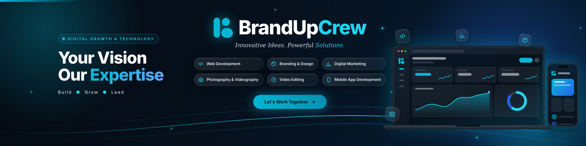
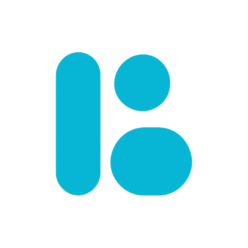

 

# BrandUpCrew

### Your Vision. Our Expertise.

**A creative digital team building experiences that move businesses forward.**

 

 

*We turn ideas into digital experiences, build meaningful brands, and create solutions that help businesses grow.*

## 👋 Who We Are

BrandUpCrew is a creative digital team that helps startups, businesses, and growing brands build a strong digital presence.

We bring together **technology**, **creativity**, and **practical business thinking** to create products and experiences that solve real problems. From websites and custom software to brand identities and marketing campaigns, every solution is shaped around the client's goals.

> **Our approach is simple:** understand the vision, focus on quality, and build for long-term growth.

 

## 🚀 What We Do

<table>
  <tr>
    <td width="33%" valign="top">
      <h4>💻 Web Development</h4>
      Modern, responsive, and high-performance websites.
    </td>
    <td width="33%" valign="top">
      <h4>⚙️ Software Development</h4>
      Custom web applications and business solutions.
    </td>
    <td width="33%" valign="top">
      <h4>🎨 Branding &amp; Design</h4>
      Brand identity, logo design, and creative visuals.
    </td>
  </tr>
  <tr>
    <td valign="top">
      <h4>📈 Digital Marketing</h4>
      Digital campaigns and online growth strategies.
    </td>
    <td valign="top">
      <h4>🔍 SEO</h4>
      Search engine optimization and organic visibility.
    </td>
    <td valign="top">
      <h4>📱 Social Media Marketing</h4>
      Social media management and content strategies.
    </td>
  </tr>
  <tr>
    <td valign="top">
      <h4>📸 Photography &amp; Videography</h4>
      Professional visual content for businesses.
    </td>
    <td valign="top">
      <h4>🎬 Video Editing</h4>
      Creative video editing and post-production.
    </td>
    <td valign="top">
      <h4>🤖 Business Automation</h4>
      Workflow automation and API integrations.
    </td>
  </tr>
</table>

 

## 🧰 Technology &amp; Expertise

**Frontend**

**Backend**

**Creative &amp; Business**

 

## ✨ What Makes Us Different

| | |
|---|---|
| 🎯 **Client-Focused** | We understand business requirements before we start. |
| 🛠️ **Quality-Driven** | Clean execution and attention to detail. |
| 💡 **Practical Solutions** | Built around real business needs. |
| 🧬 **Modern Approach** | Relevant technologies and creative methods. |
| 🌱 **Long-Term Thinking** | Solutions that grow with your business. |

 

## 🎯 Our Mission

> To help businesses turn their ideas into meaningful digital experiences through technology, creativity, and reliable solutions.

 

## 🤝 Let's Work Together

Have a project in mind, starting a business, or looking to improve your digital presence? **We would love to hear about it.**

 

### Let's Build Something Meaningful.

**Your Vision. Our Expertise.**

 

 

**© BrandUpCrew &nbsp;|&nbsp; Building Digital Experiences &amp; Growing Brands.**

